# E1-1
내 컴퓨터에 개발자용 '작업실' 꾸미기

## 1. 프로젝트 개요(미션 목표 요약)
- 리눅스 CLI(터미널), Docker(컨테이너), Git/GitHub(버전 관리 및 협업) 도구들을 사용해여 개발 환경 구축 
- 이를 통해, 같은 서비스를 여러 번 실행해도 재현되는 환경을 만드는 사고방식을 경험하는 것이 목표
- 이후 리눅스 트러블슈팅, CI/CD 파이프라인, 클라우드 배포/운영 등으로 자연스럽게 확장

## 2. 실행 환경(OS/쉘/터미널, Docker 버전, Git 버전)
- OS: Ubuntu 26.04.1 LTS
- Shell: bash
- Docker: 29.9.2
- Git: 2.53.0
```
$ echo -e "OS: $(grep -oP '(?<=PRETTY_NAME=")[^"]+' /etc/os-release)\nShell: $(basename "$SHELL")\nDocker: $(docker --version | awk '{print $3}' | tr -d ',')\nGit: $(git --version | awk '{print $3}')"
OS: Ubuntu 26.04.1 LTS
Shell: bash
Docker: 29.9.2
Git: 2.53.0
```
- 검증 증거: [env 결과](./evidence/0.env_img/0.env.png)

## 3. 레포지터리 구조
```
E1-1/
├── README.md                      # 프로젝트 전체 학습 내용 및 실습 결과 정리 문서
└── evidence/                      # 실습 과정에서 캡처한 모든 증거 자료 저장 폴더
    ├── 0.env_img/                 # OS, 쉘, Docker, Git 환경 정보 확인 증거 폴더
    ├── 1.terminal_img/            # 리눅스 CLI 기본 조작 및 파일 권한 실습 증거 폴더
    ├── 2.docker/                  # Docker 설치, 컨테이너 운영, 커스텀 이미지, 볼륨 실습 증거 폴더
    ├── 3.git/                     # Git 설정 및 GitHub 연동 증거 폴더
    ├── 4.trouble_shooting/        # 실습 중 발생한 WSL 및 볼륨 충돌 이슈 해결 증거 폴더
    └── 5.bonus/                   # 선택 보너스 과제(Git SSH 키 설정 등) 증거 폴더
```

## 4. 수행 항목 체크리스트(터미널/권한/Docker/Dockerfile/포트/볼륨/Git/GitHub)

<!--
| 분류 | 항목 | 검증 상세 | 
|---|---|---|
| 리눅스 CLI | [(1) 터미널 기본 조작](#1-터미널-기본-조작) | 현재 위치 확인, 목록 확인(숨김 파일 포함), 이동, 생성, 복사, 이동/이름변경, 삭제, 파일 내용 확인, 빈 파일 생성 |
| 리눅스 CLI | [(2) 파일 권한](#2-파일-권한) | 권한 확인/변경, 권한 변경 전/후 비교 |
| Docker | [(3) 파일 권한](#2-파일-권한) | 권한 확인/변경, 권한 변경 전/후 비교 |
-->

| 분류 | 항목 | 검증 상세 |
|---|---|---|
| 리눅스 CLI | [(1) 터미널 기본 조작](#1-터미널-기본-조작) | 현재 위치 확인, 목록 확인(숨김 파일 포함), 이동, 새폴더 생성, 빈 파일 생성, 파일 내용 확인, 복사, 이동/이름변경, 삭제 |
| 리눅스 CLI | [(2) 파일 권한](#2-파일-권한) | 권한 확인, 파일 권한 변경/확인, 디렉토리 권한 변경/확인 |
| Docker | [(1) Docker 설치](#1-docker-설치) | Docker 버전 확인, Docker 데몬 동작 여부 |
| Docker | [(2) Docker 기본 운영 명령 수행](#2-docker-기본-운영-명령-수행) | 이미지 목록 확인, running 컨테이너 확인, 전체 컨테이너 확인, 운영 로그 확인, 리소스 확인 |
| Docker | [(3) 컨테이너 실행 관리](#3-컨테이너-실행-관리) | hello-world 실행, ubuntu 실행 및 진입, exec/attach 접근 방식 및 exit 시 동작 비교 |
| Docker | [(4) 커스텀 이미지 제작](#4-기존-dockerfile-기반-커스텀-이미지-제작) | Dockerfile 기반 이미지 빌드, 커스텀 이미지 컨테이너 실행 및 브라우저 접속 |
| Docker | [(5) 포트 매핑 및 접속 증거](#5-포트-매핑-및-접속-증거) | 추가 포트 매핑 컨테이너 실행 및 브라우저 접속 확인 |
| Docker | [(6) Docker 볼륨 영속성 검증](#6-docker-볼륨-영속성-검증) | 바인드 마운트 실시간 수정 반영 검증, 볼륨 생성 및 컨테이너 간 데이터 영속성 검증 |
| Git/GitHub | [(1) Git 설정](#1-git-설정) | Git 사용자 정보 및 기본 브랜치(main) 설정 확인 |
| Git/GitHub | [(2) GitHub 연동](#2-github-연동) | VS Code와 GitHub 계정 연동 확인 |
| 트러블 슈팅 | [(1) WSL 이슈 해결](#1-docker-설치-과정에서-wsl-관련-이슈-해결) | Docker 설치 시 WSL 미설치 문제 원인 분석 및 해결 |
| 트러블 슈팅 | [(2) 볼륨 삭제 충돌 해결](#2-volume-삭제-관련-충돌-해결) | 컨테이너 점유 볼륨 삭제 에러 확인 및 선-컨테이너 삭제 후 볼륨 제거 해결 |
| 보너스 과제 | [(5) GitHub SSH 키 설정](#보너스-과제-선택) | SSH 키 생성 및 공개키 확인 |

### 1) 리눅스 CLI
터미널로 기본 적인 CLI 명령어를 수행하고, 파일의 권한을 변경 및 확인

#### (1) 터미널 기본 조작
<!-- 미널 조작 로그 기록: 명령어 + 출력 결과를 기술 문서에 기록한다. -->

- 검증 대상: **현재 위치 확인**
    - 검증 방법(명령어): `pwd`
    - 검증 결과(출력)
    ```
    $ pwd
    /home/ruav/mkj
    ```
    - 검증 증거: [`pwd` 결과](./evidence/1.terminal_img/1.pwd.png)

- 검증 대상: **목록 확인(숨김 파일 포함)**
    - 검증 방법(명령어): `ls -al`
    - 검증 결과(출력):
    ```
    $ ls -al
    total 24
    drwxr-xr-x 4 ruav ruav 4096 Nov  2 19:06 .
    drwxr-xr-x 3 ruav ruav 4096 Nov  2 18:55 ..
    drwxr-xr-x 7 ruav ruav 4096 Nov  2 18:55 .git
    -rw-r--r-- 1 ruav ruav 7386 Nov  2 20:06 README.md
    drwxr-xr-x 6 ruav ruav 4096 Nov  2 19:09 evidence
    ```
    - 검증 증거: [`ls -al` 결과](./evidence/1.terminal_img/2.ls-al.png)

- 검증 대상: **이동**
    - 검증 방법(명령어): `cd`
    - 검증 결과(출력):
    ```
    $ cd evidence
    ruav@DESKTOP-9HA9I8V:~/mkj/E1-1/evidence$
    ```
    - 검증 증거: [`cd` 결과](./evidence/1.terminal_img/3.cd.png)

- 검증 대상: **새폴더 생성**
    - 검증 방법(명령어): `mkdir`
    - 검증 결과(출력):
    ```
    $ mkdir new_dir
    $ ls
    README.md  evidence  new_dir
    ```
    - 검증 증거: [`mkdir` 결과](./evidence/1.terminal_img/4.mkdir.png)

- 검증 대상: **빈 파일 생성**
    - 검증 방법(명령어): `touch`
    - 검증 결과(출력):
    ```
    $ touch hello.txt
    $ cat hello.txt
    $ ls -al
    total 32
    drwxr-xr-x 5 ruav ruav 4096 Nov  2 20:37 .
    drwxr-xr-x 3 ruav ruav 4096 Nov  2 18:55 ..
    drwxr-xr-x 7 ruav ruav 4096 Nov  2 18:55 .git
    -rw-r--r-- 1 ruav ruav 9549 Nov  2 20:37 README.md
    drwxr-xr-x 6 ruav ruav 4096 Nov  2 20:30 evidence
    -rw-r--r-- 1 ruav ruav    0 Nov  2 20:37 hello.txt
    drwxr-xr-x 2 ruav ruav 4096 Nov  2 20:30 new_dir
    ```
    - 검증 증거: [`touch` 결과](./evidence/1.terminal_img/5.touch.png)


- 검증 대상: **파일 내용 확인**
    - 검증 방법(명령어): `cat`
    - 검증 결과(출력):
    ```
    $ cat hello.txt
    $ echo "Hello world!" > hello.txt
    $ cat hello.txt
    Hello world!

    $ echo "Welcome to Linux!" >> hello.txt
    $ cat hello.txt
    Hello world!
    Welcome to Linux!
    ```
    - 검증 증거: [`cat` 결과](./evidence/1.terminal_img/6.cat.png)

- 검증 대상: **복사**
    - 검증 방법(명령어): `cp`
    - 검증 결과(출력):
    ```
    $ cp hello.txt hello_copy.txt
    $ ls
    README.md  evidence  hello.txt  hello_copy.txt  new_dir    
    ```
    - 검증 증거: [`cp` 결과](./evidence/1.terminal_img/7.cp.png)

- 검증 대상: **이동/이름변경**
    - 검증 방법(명령어): `mv`
    - 검증 결과(출력):
    ```
    $ mv hello_copy.txt hello_copy_copy.txt
    $ ls
    README.md  evidence  hello.txt  hello_copy_copy.txt  new_dir    
    
    $ mv hello_copy_copy.txt new_dir/hello_copy_copy.txt
    $ cd new_dir/
    $ ls
    hello_copy_copy.txt
    ```
    - 검증 증거: [`mv` 결과](./evidence/1.terminal_img/8.mv.png)

- 검증 대상: **삭제**
    - 검증 방법(명령어): `rm`
    - 검증 결과(출력):
    ```
    $ ls
    hello_copy_copy.txt
    $ rm hello_copy_copy.txt 
    $ ls
    ```
    - 검증 증거: [`rm` 결과](./evidence/1.terminal_img/9.rm.png)

#### (2) 파일 권한
<!-- 권한을 확인/변경하는 명령을 수행하고, 변경 전/후 비교를 기술 문서에 남긴다.
최소 요구: 파일 1개, 디렉토리 1개에 대해 권한 변경 실험을 수행한다. -->
- 검증 대상: **권한 확인**
    - 검증 방법(명령어): `ls -l`
    - 검증 결과(출력):
    ```
    $ ls -l
    total 24
    -rw-r--r-- 1 ruav ruav 10931 Nov  2 21:44 README.md
    drwxr-xr-x 6 ruav ruav  4096 Nov  2 20:30 evidence
    -rw-r--r-- 1 ruav ruav    31 Nov  2 20:42 hello.txt
    drwxr-xr-x 2 ruav ruav  4096 Nov  2 20:51 new_dir
    ```
    - 검증 증거: [`ls-l` 결과](./evidence/1.terminal_img/10.ls-l.png)

- 검증 대상: **파일 권한 변경/확인**
    - 검증 방법(명령어): `chmod`
    - 검증 결과(출력):
    ```
    $ ls -l
    total 24
    -rw-r--r-- 1 ruav ruav 11826 Nov  2 21:51 README.md
    drwxr-xr-x 6 ruav ruav  4096 Nov  2 20:30 evidence
    -rwxrw-rw- 1 ruav ruav    31 Nov  2 20:42 hello.txt
    drwxr-xr-x 2 ruav ruav  4096 Nov  2 20:51 new_dir
    ```
    - 검증 증거: [`chmod` 결과](./evidence/1.terminal_img/11.chmod_file.png) 

- 검증 대상: **디렉토리 권한 변경/확인**
    - 검증 방법(명령어): `chmod`
    - 검증 결과(출력):
    ```
    $ ls -l
    total 28
    -rw-r--r-- 1 ruav ruav 12304 Nov  2 22:17 README.md
    drwxr-xr-x 6 ruav ruav  4096 Nov  2 20:30 evidence
    -rwxrw-rw- 1 ruav ruav    31 Nov  2 20:42 hello.txt
    drwxr--r-- 2 ruav ruav  4096 Nov  2 20:51 new_dir
    ```
    - 검증 증거: [`chmod` 결과](./evidence/1.terminal_img/12.chmod_file.png) 


### 2) Docker 설치 및 기본 점검

#### (1) Docker 설치
- 검증 대상: **Docker 버전 확인**
    - 검증 방법(명령어): `docker --version`
    - 검증 결과(출력):
    ```
    $ docker --version
    Docker version 29.9.2, build a82e528
    ```
    - 검증 증거: [`docker --version` 결과](./evidence/2.docker/1-1.docker--version.png) 

- 검증 대상: **Docker 데몬 동작 여부**
    - 검증 방법(명령어): `docker info`
    - 검증 결과(출력):
    ```
    $ docker info
    Client:
    Version:    29.9.2
    Context:    desktop-linux
    Debug Mode: false
    Plugins:
    agent: Docker AI Agent Runner (Docker Inc.)
        Version:  v1.152.0
        Path:     C:\Program Files\Docker\cli-plugins\docker-agent.exe
    ai: Docker AI Agent - Ask Gordon (Docker Inc.)
        Version:  v1.33.0
        Path:     C:\Program Files\Docker\cli-plugins\docker-ai.exe
    buildx: Docker Buildx (Docker Inc.)
        Version:  v0.38.1
        Path:     C:\Program Files\Docker\cli-plugins\docker-buildx.exe
    compose: Docker Compose (Docker Inc.)
        Version:  v5.6.1
        Path:     C:\Program Files\Docker\cli-plugins\docker-compose.exe
    debug: Get a shell into any image or container (Docker Inc.)
        Version:  0.49.0
        Path:     C:\Program Files\Docker\cli-plugins\docker-debug.exe
    desktop: Docker Desktop commands (Docker Inc.)
        Version:  4.97.0
        Path:     C:\Program Files\Docker\cli-plugins\docker-desktop.exe
    dhi: CLI for managing Docker Hardened Images (Docker Inc.)
        Version:  v0.0.9
        Path:     C:\Program Files\Docker\cli-plugins\docker-dhi.exe
    extension: Manages Docker extensions (Docker Inc.)
        Version:  v0.2.32
        Path:     C:\Program Files\Docker\cli-plugins\docker-extension.exe
    init: Creates Docker-related starter files for your project (Docker Inc.)
        Version:  v1.4.1
        Path:     C:\Program Files\Docker\cli-plugins\docker-init.exe
    mcp: Docker MCP Plugin (Docker Inc.)
        Version:  v0.44.2
        Path:     C:\Program Files\Docker\cli-plugins\docker-mcp.exe
    model: Docker Model Runner (Docker Inc.)
        Version:  v1.2.9
        Path:     C:\Program Files\Docker\cli-plugins\docker-model.exe
    offload: Docker Offload (Docker Inc.)
        Version:  v0.7.21
        Path:     C:\Program Files\Docker\cli-plugins\docker-offload.exe
    pass: Docker Pass Secrets Manager Plugin (beta) (Docker Inc.)
        Version:  v0.3.2
        Path:     C:\Program Files\Docker\cli-plugins\docker-pass.exe
    sandbox: "docker sandbox" is deprecated, use Docker Sandboxes instead (Docker Inc.)
        Version:  v0.13.0
        Path:     C:\Program Files\Docker\cli-plugins\docker-sandbox.exe
    scout: Docker Scout (Docker Inc.)
        Version:  v1.27.0
        Path:     C:\Program Files\Docker\cli-plugins\docker-scout.exe

    Server:
    Containers: 0
    Running: 0
    Paused: 0
    Stopped: 0
    Images: 0
    Server Version: 29.9.2
    Storage Driver: overlayfs
    driver-type: io.containerd.snapshotter.v1
    Logging Driver: local
    Cgroup Driver: cgroupfs
    Cgroup Version: 2
    Plugins:
    Volume: local
    Network: bridge host ipvlan macvlan null overlay
    Log: awslogs fluentd gcplogs gelf journald json-file local splunk syslog
    CDI spec directories:
    /etc/cdi
    /var/run/cdi
    Discovered Devices:
    cdi: docker.com/gpu=webgpu
    Swarm: inactive
    Runtimes: io.containerd.runc.v2 nvidia runc
    Default Runtime: runc
    Init Binary: docker-init
    containerd version: b7a25261e029d68978bbf290df0a62fc819b3c51
    runc version: v1.5.2-0-g29dd3dc2
    init version: de40ad0
    Security Options:
    seccomp
    Profile: builtin
    cgroupns
    Kernel Version: 6.18.54.1-microsoft-standard-WSL2
    Operating System: Docker Desktop
    OSType: linux
    Architecture: x86_64
    CPUs: 12
    Total Memory: 7.577GiB
    Name: docker-desktop
    ID: 982a4296-0df7-401f-b6a6-954bf9a00c8b
    Docker Root Dir: /var/lib/docker
    Debug Mode: false
    HTTP Proxy: http.docker.internal:3128
    HTTPS Proxy: http.docker.internal:3128
    No Proxy: hubproxy.docker.internal
    Labels:
    com.docker.desktop.address=npipe://\\.\pipe\docker_cli
    Experimental: false
    Insecure Registries:
    hubproxy.docker.internal:5555
    127.0.0.0/8
    ::1/128
    Live Restore Enabled: false
    Firewall Backend: iptables
    ```
    - 검증 증거: [`docker info` 결과](./evidence/2.docker/1-2.docker-info.png) 

#### (2) Docker 기본 운영 명령 수행
docker run hello-world 실행 후 
docker images, docker ps -a, docker logs, docker stats 등 운영 명령 실행 흔적

운영: 로그 확인 (예: docker logs), 리소스 확인 (예: docker stats)
수행 명령과 출력 결과를 기술 문서에 남긴다.

- 검증 대상: **Docker 이미지 다운로드/목록 확인**
    - 검증 방법(명령어): `docker images`
    - 검증 결과(출력):
    ```
    $ docker images
    IMAGE                ID             DISK USAGE   CONTENT SIZE   EXTRA
    hello-world:latest   c567b231f656       25.9kB         9.49kB    U   
    ubuntu:latest        6a06111c3b0a        163MB         45.9kB    U   
    ```
    - 검증 증거: [`docker images` 결과](./evidence/2.docker/2-1.docker-images.png)

- 검증 대상: **Docker 컨테이너 실행/중지/목록 확인 (현재 running 중인 up 상태의 컨테이너)**
    - 검증 방법(명령어): `docker ps`
    - 검증 결과(출력):
    ```
    $ docker ps -a
    CONTAINER ID   IMAGE         COMMAND       CREATED          STATUS                      PORTS     NAMES
    c18c2fb905d6   ubuntu        "/bin/bash"   7 minutes ago    Exited (0) 6 minutes ago              mybox
    ```
    - 검증 증거: [`docker ps` 결과](./evidence/2.docker/2-2.docker-ps.png)


- 검증 대상: **Docker 컨테이너 실행/중지/목록 확인 (모든 컨테이너)**
    - 검증 방법(명령어): `docker ps -a`
    - 검증 결과(출력):
    ```
    $ docker ps -a
    CONTAINER ID   IMAGE         COMMAND       CREATED          STATUS                      PORTS     NAMES
    c18c2fb905d6   ubuntu        "/bin/bash"   7 minutes ago    Exited (0) 6 minutes ago              mybox
    1e27a1d049d8   hello-world   "/hello"      42 minutes ago   Exited (0) 28 minutes ago             sharp_neumann
    ```
    - 검증 증거: [`docker ps -a` 결과](./evidence/2.docker/2-3.docker-ps-a.png)

- 검증 대상: **Docker 운영 로그 확인**
    - 검증 방법(명령어): `docker logs mybox`
    - 검증 결과(출력):
    ```
    $ docker logs mybox
    root@c18c2fb905d6:/# ls
    bin  boot  dev  etc  home  lib  lib64  media  mnt  opt  proc  root  run  sbin  srv  sys  tmp  usr  var
    root@c18c2fb905d6:/# echo "ubuntu in the mybox container" 
    ubuntu in the mybox container
    root@c18c2fb905d6:/# exit
    exit
    ```
    - 검증 증거: [`docker logs mybox` 결과](./evidence/2.docker/2-4.docker-logs-mybox.png)

- 검증 대상: **Docker 리소스 확인**
    - 검증 방법(명령어): `docker stats --no-stream`
    - 검증 결과(출력):
    ```
    $ docker stats --no-stream
    CONTAINER ID   NAME      CPU %     MEM USAGE / LIMIT    MEM %     NET I/O         BLOCK I/O     PIDS
    c18c2fb905d6   mybox     0.00%     4.512MiB / 7.577GiB   0.06%     1.17kB / 126B   20.6MB / 0B   1    
    ```
    - 검증 증거: [`docker stats --no-stream` 결과](./evidence/2.docker/2-5.docker-stats--no-stream.png)


#### (3) 컨테이너 실행 관리

- 검증 대상: **Docker 테스트용 이미지 hello-world 실행**
    - 검증 방법(명령어): `docker run hello-world`
    - 검증 결과(출력):
    ```
    $ docker run hello-world
    Unable to find image 'hello-world:latest' locally
    latest: Pulling from library/hello-world
    4f55086f7dd0: Pull complete 
    d5e71e642bf5: Download complete 
    Digest: sha256:c567b231f65614688711a75f31518a064258a51d442117a3e771a3a8fdba78ef
    Status: Downloaded newer image for hello-world:latest

    Hello from Docker!
    This message shows that your installation appears to be working correctly.

    To generate this message, Docker took the following steps:
    1. The Docker client contacted the Docker daemon.
    2. The Docker daemon pulled the "hello-world" image from the Docker Hub.
        (amd64)
    3. The Docker daemon created a new container from that image which runs the
        executable that produces the output you are currently reading.
    4. The Docker daemon streamed that output to the Docker client, which sent it
        to your terminal.

    To try something more ambitious, you can run an Ubuntu container with:
    $ docker run -it ubuntu bash

    Share images, automate workflows, and more with a free Docker ID:
    https://hub.docker.com/

    For more examples and ideas, visit:
    https://docs.docker.com/get-started/
    ```
    - 검증 증거: [`docker run hello-world` 결과](./evidence/2.docker/3-1.docker-run-hello-world.png)

- 검증 대상: **컨테이너로 Ubuntu 실행 후 내부 진입하여 명령(`ls`, `echo` 등) 수행**
    - 검증 방법(명령어): `docker run -it --name mybox ubuntu`
    - 검증 결과(출력):
    ```
    $ docker run -it --name mybox ubuntu
    Unable to find image 'ubuntu:latest' locally
    latest: Pulling from library/ubuntu
    f3f25b84a7d7: Pull complete 
    edafa32f5d9e: Pull complete 
    21594acc2d8b: Download complete 
    Digest: sha256:6a06111c3b0a8600feadb270aec771dc239bf407b25625f93f44ab00e11f4d3c
    Status: Downloaded newer image for ubuntu:latest
    root@c18c2fb905d6:/# ls
    bin  boot  dev  etc  home  lib  lib64  media  mnt  opt  proc  root  run  sbin  srv  sys  tmp  usr  var
    root@c18c2fb905d6:/# echo "ubuntu in the mybox container" 
    ubuntu in the mybox container
    root@c18c2fb905d6:/# exit
    exit
    ```
    - 검증 증거: [`docker run -it --name mybox ubuntu` 결과](./evidence/2.docker/3-2.docker-run-mybox.png)

- 검증 대상: **컨테이너 접근 방식 비교 (exit 실행 시 유지)**
    - 검증 방법(명령어): `docker exec`
    - 검증 결과(출력):
    ```
    $ docker ps
    CONTAINER ID   IMAGE     COMMAND       CREATED             STATUS          PORTS     NAMES
    c18c2fb905d6   ubuntu    "/bin/bash"   About an hour ago   Up 19 seconds             mybox
    PS C:\Users\User\Desktop\mkj\E1-1> docker ps -a
    CONTAINER ID   IMAGE         COMMAND       CREATED             STATUS                   PORTS     NAMES
    c18c2fb905d6   ubuntu        "/bin/bash"   About an hour ago   Up 23 seconds                      mybox
    1e27a1d049d8   hello-world   "/hello"      2 hours ago         Exited (0) 2 hours ago             sharp_neumann
    
    $ docker exec -it mybox /bin/bash
    root@c18c2fb905d6:/# exit
    exit

    What's next:
        Try Docker Debug for seamless, persistent debugging tools in any container or image → docker debug mybox
        Learn more at https://docs.docker.com/go/debug-cli/

    $ docker exec -it sharp_neumann /bin/bash
    Error response from daemon: container 1e27a1d049d8454c1355a87ceb6ddc10e6aad125d080a5fc480e5deded277afb is not running

    What's next:
        Try Docker Debug for seamless, persistent debugging tools in any container or image → docker debug sharp_neumann
        Learn more at https://docs.docker.com/go/debug-cli/

    $ docker ps                              
    CONTAINER ID   IMAGE     COMMAND       CREATED             STATUS          PORTS     NAMES
    c18c2fb905d6   ubuntu    "/bin/bash"   About an hour ago   Up 53 seconds             mybox
    ```
    &rarr; 현재 running 중인 컨테이너만 exec으로 접근 가능하고, exit 실행해도 컨테이너가 **유지**됨
    - 검증 증거: [`docker exec` 결과](./evidence/2.docker/3-3.docker-exec.png)

- 검증 대상: **컨테이너 접근 방식 비교 (exit 실행 시 종료)**
    - 검증 방법(명령어): `docker attach`
    - 검증 결과(출력):
    ```
    $ docker ps -a                           
    CONTAINER ID   IMAGE         COMMAND       CREATED             STATUS                   PORTS     NAMES
    c18c2fb905d6   ubuntu        "/bin/bash"   About an hour ago   Up 10 seconds                      mybox
    1e27a1d049d8   hello-world   "/hello"      2 hours ago         Exited (0) 2 hours ago             sharp_neumann
    
    $ docker attach sharp_neumann
    cannot attach to a stopped container, start it first

    $ docker attach mybox         
    root@c18c2fb905d6:/# exit
    exit
    
    $ docker ps                  
    CONTAINER ID   IMAGE     COMMAND   CREATED   STATUS    PORTS     NAMES  
    ```
    &rarr; 현재 running 중인 컨테이너만 접근 가능하나, exit 실행 시 컨테이너가 **종료**됨
    - 검증 증거: [`docker attach` 결과](./evidence/2.docker/3-4.docker-attach.png)


- 간단한 웹 서버를 Dockerfile로 컨테이너화
- 포트 매핑으로 접속을 확인
- 바인드 마운트/볼륨으로 "변경 반영"과 "데이터 영속성"을 직접 검증


#### (4) 기존 Dockerfile 기반 커스텀 이미지 제작
아래 방식 중 하나를 선택하여 기존 Dockerfile/이미지 기반의 커스텀 이미지를 만든다.
(A) 웹 서버 베이스 이미지 활용(예: NGINX/Apache 등) + 정적 콘텐츠/설정만 교체
(B) Linux 베이스 이미지(예: ubuntu/alpine 등) + 기본 기능(패키지/사용자/환경변수/헬스체크 등) 추가

- 기존 베이스 이미지/Dockerfile: **웹 서버 베이스 이미지 (NGINX)**
- 커스텀 포인트: 기존 nginx(웹 서버) 이미지를 가져와 정적 콘텐츠(html 파일) 하나만 바꿔 넣은 "커스텀 이미
지"를 만들고, 포트를 연결해 브라우저로 접속

- 검증 대상: **기존 Dockerfile 기반 커스텀 이미지 제작 및 빌드**
    - 검증 방법(명령어): `docker build -t my-web .`
    - 검증 결과(출력):
    ```
    $ docker build -t my-web .                          
    [+] Building 11.7s (7/7) [+] Building 11.7s (7/7)FINISHED                                                                                                                                                        docker:desktop-linux
    => [internal] load build definition from Dockerfile  
    ...

    $ docker images  
    my-web:latest   f0a58dcafe93        241MB         63.9MB        
    ```
    - 검증 증거: [`docker build` 결과](./evidence/2.docker/4-1.docker_build-t_my-web_.png)
    
- 검증 대상: **커스텀 이미지 기반 컨테이너 실행**
    - 검증 방법(명령어): `docker run -d -p 8080:80 --name my-web_cnt my-web`
    - 검증 결과(출력):
    ```
    $ docker ps -a                                     
    CONTAINER ID   IMAGE     COMMAND   CREATED   STATUS    PORTS     NAMES
    
    $ docker run -d -p 8080:80 --name my-web_cnt my-web
    27d868f12584a4c323a067cb490fbf03e6b5935eb3ff7f4052df0901dc92db2d
    
    $ docker ps                                        
    CONTAINER ID   IMAGE     COMMAND                   CREATED         STATUS         PORTS                                     NAMES
    27d868f12584   my-web    "/docker-entrypoint.…"   7 seconds ago   Up 7 seconds   0.0.0.0:8080->80/tcp, [::]:8080->80/tcp   my-web_cnt       
    ```
    - 검증 증거: [`docker run -d -p 8080:80 --name my-web_cnt my-web` 결과](./evidence/2.docker/4-2.docker_run_custom.png)
    - 실행 증거: <br>
    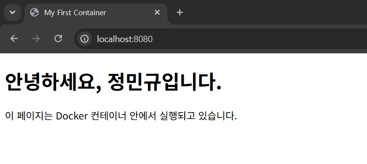

#### (5) 포트 매핑 및 접속 증거
- 검증 대상: **포트 매핑 및 접속 여부**
    - 검증 방법(명령어): `docker run -d -p 8081:80 --name my-web_cnt_2 my-web`
    - 검증 결과(출력):
    ```
    $ docker ps
    CONTAINER ID   IMAGE     COMMAND                   CREATED         STATUS         PORTS                                     NAMES
    27d868f12584   my-web    "/docker-entrypoint.…"   7 minutes ago   Up 7 minutes   0.0.0.0:8080->80/tcp, [::]:8080->80/tcp   my-web_cnt
    
    $ docker run -d -p 8081:80 --name my-web_cnt_2 my-web   
    fcfb4e9be2762a3175aaf2422453f124526d50037afb6af23212618f4ff1c047
    
    $ docker ps                                          
    CONTAINER ID   IMAGE     COMMAND                   CREATED         STATUS         PORTS                                     NAMES
    fcfb4e9be276   my-web    "/docker-entrypoint.…"   2 seconds ago   Up 2 seconds   0.0.0.0:8081->80/tcp, [::]:8081->80/tcp   my-web_cnt_2
    27d868f12584   my-web    "/docker-entrypoint.…"   7 minutes ago   Up 7 minutes   0.0.0.0:8080->80/tcp, [::]:8080->80/tcp   my-web_cnt     
    ```
    - 검증 증거: [`docker run -d -p 8081:80 --name my-web_cnt_2 my-web` 추가 포트 매핑 결과](./evidence/2.docker/5-1.port_mapping.png)
    - 실행 증거: <br>
    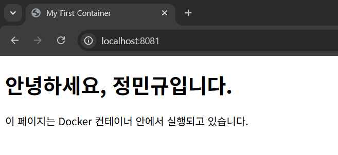


#### (6) Docker 볼륨 영속성 검증

- 검증 대상: **바인드 마운트 (내 폴더를 컨테이너에 연결)**
    - 검증 방법(명령어): `docker run -d -p 8082:80 --name my-web-live -v ${PWD}:/usr/share/nginx/html nginx`
    - 검증 결과(출력):
    ```
    $ docker run -d -p 8082:80 --name my-web-live -v ${PWD}:/usr/share/nginx/html nginx
    120661faf420988a47fad3329b8ae0a6ea81e8c9ee8bb2753e039404294d90dd
    
    $ docker ps                                          
    CONTAINER ID   IMAGE     COMMAND                   CREATED         STATUS         PORTS                                     NAMES
    120661faf420   nginx     "/docker-entrypoint.…"   5 seconds ago   Up 4 seconds   0.0.0.0:8082->80/tcp, [::]:8082->80/tcp   my-web-live     
    ```
    - 검증 증거: [`docker run -d -p 8082:80 --name my-web-live -v ${PWD}:/usr/share/nginx/html nginx` 바인드 마운트 결과](./evidence/2.docker/6-1.bind_mount.png)
    - 실행 증거: <br>
        - 바인드 마운트 브라우저 실행 결과 (html 파일 수정 전) <br>
            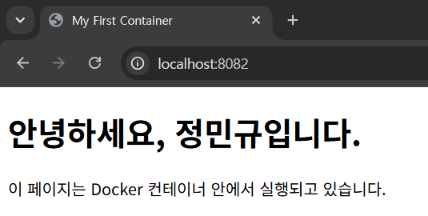
        - html 파일 수정 <br>
            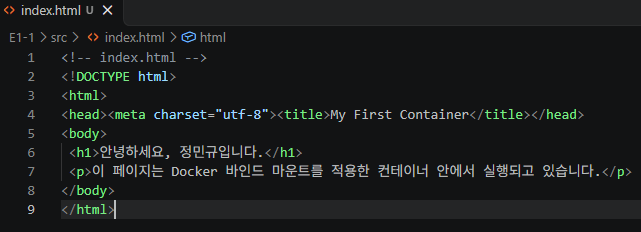
        - 바인드 마운트 브라우저 새로 고침 실행 시 <br>
            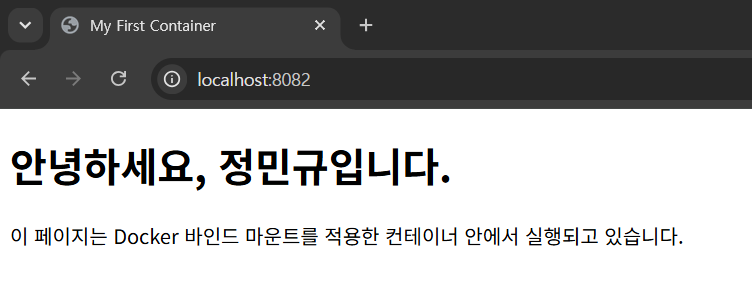


- 검증 대상: **볼륨 (Docker가 관리하는 저장 공간)**
    - 검증 방법(명령어): `docker volume create mydata`
    - 검증 결과(출력):
    ```
    $ docker volume create mydata # 도커 볼륨 생성
    mydata
    
    $ docker run -it --name vol-test-cnt -v mydata:/data ubuntu # 컨테이너에 연결
    root@767901c96773:/# echo "hello volume!" > /data/memo.txt
    root@767901c96773:/# exit
    exit
    
    $ docker rm vol-test-cnt # 연결한 컨테이너 삭제
    vol-test-cnt
    
    $ docker run -it --name vol-check-cnt -v mydata:/data ubuntu # 새로운 컨테이너와 연결                 
    root@ce322bd6edb8:/# cat /d
    data/ dev/  
    root@ce322bd6edb8:/# cat /data/memo.txt 
    hello volume! # 데이터 유지 확인
    root@ce322bd6edb8:/# exit
    exit
    
    $ docker volume ls
    DRIVER    VOLUME NAME
    local     mydata     
    ```
    - 검증 증거: [`docker volume create mydata` 볼륨 결과](./evidence/2.docker/6-5.volume.png)

&rarr; "왜 이런 설계가 필요한지"를 설명 가능한 형태로 정리
- 이미지와 컨테이너의 분리
    - 동일한 이미지를 이용해서 여러 개의 컨테이너를 실행할 때, 공통적으로 사용되는 데이터를 매번 저장하면 컨테이너 자체가 무거워짐
- 격리된 실행 환경
    - 컨테이너와 데이터를 격리해서 관리 가능
- 포트·스토리지 연결 방식
    - 컨테이너와 외부를 독립

### 3) Git/GitHub
- Git 설정 및 GitHub/VSCode 연동 증거

#### (1) Git 설정
- 검증 대상: **Git 사용자 정보/기본 브랜치 설정**
    - 검증 방법(명령어): `git config user.name`, `git config user.email`, `git config --global init.defaultBranch main` (계정은 프로젝트 폴더에 한정)
    - 검증 결과(출력):
    ```
    $ git config user.name wjdalsrb129
    
    $ git config user.email wjdalsrb129@gamli.com
    
    $ git config --global init.defaultBranch main
    
    $ git config --list
    diff.astextplain.textconv=astextplain
    filter.lfs.clean=git-lfs clean -- %f
    filter.lfs.smudge=git-lfs smudge -- %f
    filter.lfs.process=git-lfs filter-process
    filter.lfs.required=true
    http.sslbackend=schannel
    core.autocrlf=true
    core.fscache=true
    core.symlinks=false
    pull.rebase=false
    credential.helper=manager
    credential.https://dev.azure.com.usehttppath=true
    init.defaultbranch=master
    init.defaultbranch=main
    core.repositoryformatversion=0
    core.filemode=false
    core.bare=false
    core.logallrefupdates=true
    core.symlinks=false
    core.ignorecase=true
    remote.origin.url=https://github.com/wjdalsrb129/E1-1.git
    remote.origin.fetch=+refs/heads/*:refs/remotes/origin/*
    branch.main.remote=origin
    branch.main.merge=refs/heads/main
    branch.main.vscode-merge-base=origin/main
    user.name=wjdalsrb129
    user.email=wjdalsrb129@gmail.com
    ```
    - 검증 증거: [`git config` git 설정 결과](./evidence/3.git/1.git_setting.png) 

#### (2) GitHub 연동
- 검증 대상: **GitHub 로그인 및 저장소와 vs code 연동**
    - 검증 방법(명령어): vs code에서 github 연동
    - 검증 증거: <br> 
        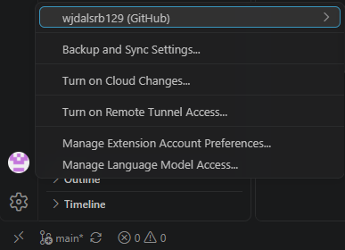 
        

### 4) 트러블 슈팅
#### (1) Docker 설치 과정에서 WSL 관련 이슈 해결
- 문제: Docker 설치 후 정상적으로 실행되지 않음 <br><br>
    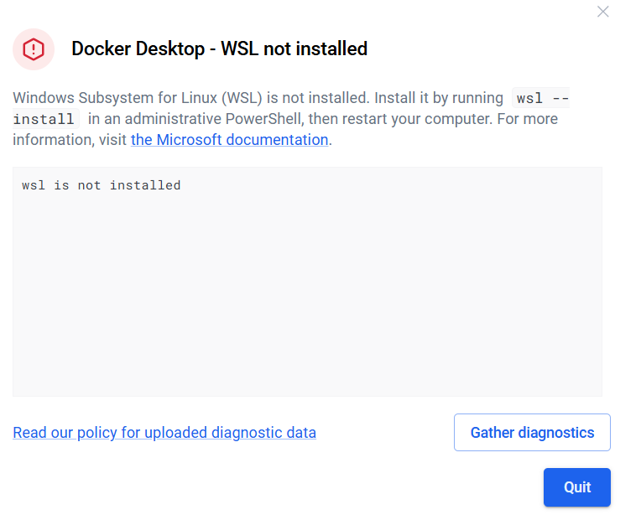
- 원인 가설: **WSL이 사전에 먼저 설치되어 있어야 한다.**
- 확인: WSL을 설치함 <br><br>
    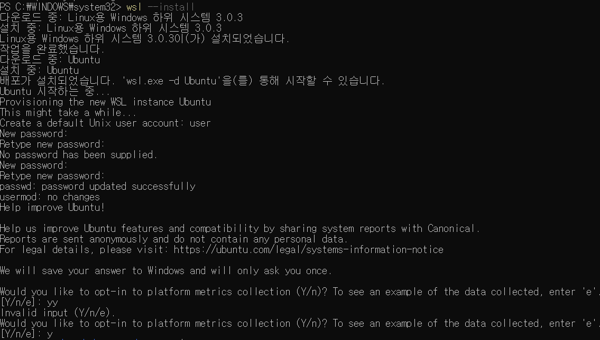
- 해결/대안: **WSL 설치 후 Docker가 정상적으로 설치된 것을 확인함** <br><br>
    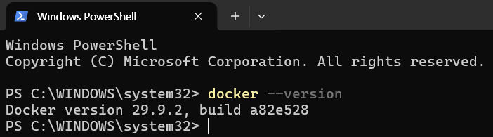

#### (2) volume 삭제 관련 충돌 해결
- 문제: 'mydata' volume 삭제 시도 시 해당 볼륨이 특정 컨테이너에서 사용중이라 삭제가 안 되는 이슈 발생 <br><br>
    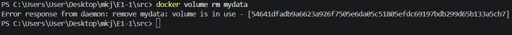
- 원인 가설: **volume과 연동되어 있는 컨테이너를 먼저 삭제해야 volume을 삭제할 수 있을 것이다.**
- 확인: `docker ps -a`로 해당 볼륨에 연결된 컨테이너를 확인 <br><br>
    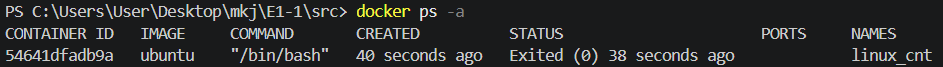
- 해결/대안: **컨테이너를 먼저 삭제한 뒤 volume을 삭제할 수 있었음** <br><br>
    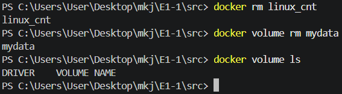


## 보너스 과제 (선택)
1. Docker Compose 기초
    - docker-compose.yml의 기본 구조를 학습하고, 단일 서비스를 Compose로 실행한다.
    - 배움 포인트: 컨테이너 실행 명령이 “문서화된 실행 설정”으로 바뀌는 이유
2. Docker Compose 멀티 컨테이너
    - 웹 서버 + (임의의 보조 서비스) 2개 이상을 Compose로 함께 실행한다.
    - 컨테이너 간 네트워크 통신이 가능한지 확인한다.
    - 배움 포인트: 네트워크/서비스 디스커버리 개념 맛보기
3. Compose 운영 명령어 습득
    - up, down, ps, logs를 사용해 실행/종료/상태/로그를 관리한다.
    - 배움 포인트: 운영 관점의 “상태 확인 루틴” 만들기
4. 환경 변수 활용
    - Dockerfile 또는 Compose에서 환경 변수를 주입해 서버 포트/모드를 바꿔본다.
    - 배움 포인트: 설정과 코드의 분리
5. GitHub SSH 키 설정
    - HTTPS 대신 SSH로 푸시가 가능하도록 키를 등록하고 동작을 확인한다.
    - 배움 포인트: 인증 방식 차이와 보안 습관
    - 검증 방법(명령어): `ssh-keygen -t ed25519 -C wjdalsrb129@gmail.com`, `cat ~/.ssh/id_ed25519.pub`
        - 검증 결과(출력): <br><br>
            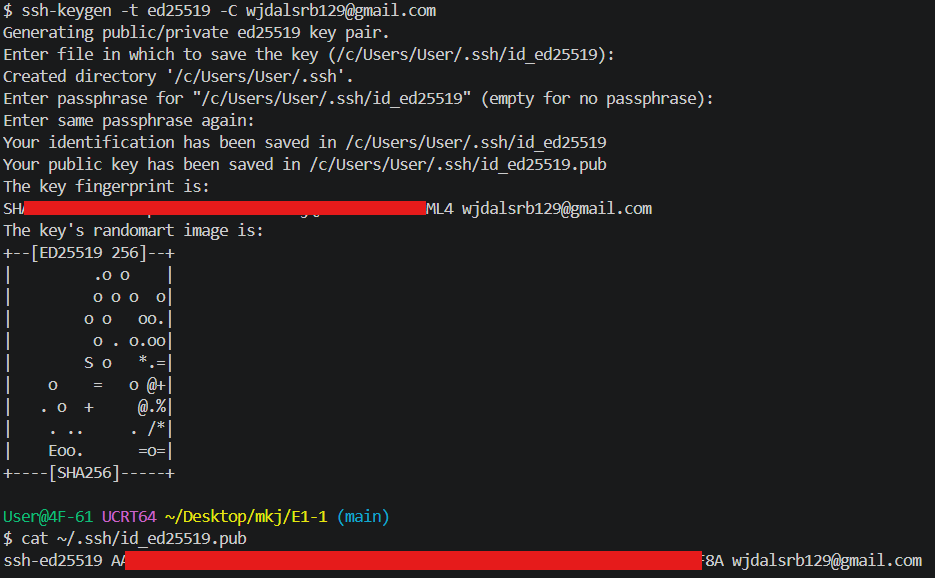
            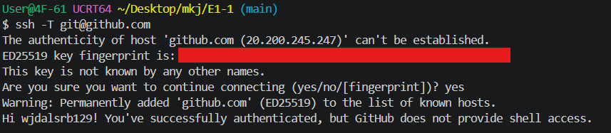


## 과제 목표

### 1. 절대 경로와 상대 경로의 차이
- **절대 경로**: 최상위 루트 디렉토리(`/` 또는 `C:\`)부터 시작하여 목적지까지의 **전체 경로**를 모두 나열하는 방식
  - *예시 (Linux)*: `/home/user/project/src/index.html`
- **상대 경로**: **현재 내가 위치한 디렉토리**를 기준으로 목적지의 상대적인 위치를 표현하는 방식으로, 프로젝트를 다른 환경이나 다른 사용자의 컴퓨터로 옮겨 실행할 때 경로가 깨지지 않도록 유지하는 데 필수적인 방식
  - *예시 (현재 `/home/user/project`에 있을 때)*: `./src/index.html` 또는 `src/index.html`
---
### 2. 파일 권한(r/w/x)과 755, 644 표기법
Linux/Unix 환경에서 파일과 디렉토리에 접근할 수 있는 권한을 나타냄.

- **권한의 종류**:
  - **`r` (Read, 읽기)**: 파일 내용 조회 또는 디렉토리 내부 목록 확인 (숫자 값: `4`)
  - **`w` (Write, 쓰기)**: 파일 수정/삭제 또는 디렉토리 내부 파일 생성/삭제 (숫자 값: `2`)
  - **`x` (Execute, 실행)**: 파일을 프로그램으로 실행하거나 디렉토리 내부로 진입 (숫자 값: `1`)

- **숫자 표기법(예: 755, 644) 해석 규칙**:
  - 권한은 **[소유자(User) 권한] [그룹(Group) 권한] [기타 사용자(Others) 권한]**의 3자리 숫자로 구성
  - 각 자리는 `r`(4), `w`(2), `x`(1)의 숫자를 더해서 만들어짐
  - **`755`**: 소유자는 읽기/쓰기/실행(`4+2+1=7`), 그룹과 기타 사용자는 읽기/실행(`4+1=5`) 가능 (주로 실행 파일이나 스크립트 파일에 사용)
  - **`644`**: 소유자는 읽기/쓰기(`4+2=6`), 그룹과 기타 사용자는 읽기 전용(`4`) 가능 (주로 일반 소스코드나 설정 파일에 사용)
---
### 3. 기존 Dockerfile을 기반으로 한 "커스텀 이미지" 제작
기존에 존재하는 베이스 이미지(예: `ubuntu`, `nginx` 등)를 바탕으로 사용자가 원하는 설정, 소스 코드, 패키지 등을 추가하여 새로운 이미지를 만드는 과정.

    1. 프로젝트 디렉토리에 `Dockerfile` 이름의 파일을 생성
    2. `FROM` 명령어로 기반이 될 이미지를 지정
    3. `COPY`, `RUN`, `WORKDIR` 등의 명령어로 필요한 파일과 설정을 추가
    4. `docker build -t [이미지이름] .` 명령어를 실행하여 커스텀 이미지를 빌드
---
### 4. 포트 매핑이 필요한 이유
도커 컨테이너는 기본적으로 호스트(내 컴퓨터)와 격리된 **독립적인 네트워크 환경**을 갖는데, 
- 컨테이너 내부에서 구동되는 웹서버(예: Nginx, 80번 포트)는 외부에서 바로 접근할 수 없음
- 따라서 호스트 컴퓨터의 특정 포트(예: 8080)와 컨테이너 내부 포트(예: 80)를 연결(`-p 8080:80`)해 주는 **포트 매핑**을 통해, 외부(내 컴퓨터의 웹 브라우저 등)에서 컨테이너 내부의 서비스로 안전하게 접근할 수 있게 됨.

---

### 5. Docker 볼륨(영속 데이터)의 개념
도커 컨테이너는 삭제되거나 재생성되면 내부의 데이터도 함께 사라지는 **휘발성** 특징을 갖지만,
- **Docker 볼륨**: 컨테이너의 생명주기와 상관없이 데이터를 안전하게 보존(영속성)하기 위해, 호스트 컴퓨터의 특정 공간이나 도커가 관리하는 별도의 영역을 컨테이너 내부 폴더와 연결(마운트)하는 기능
- 이를 통해 컨테이너가 삭제되어도 데이터는 유실되지 않고 안전하게 유지됨
---
### 6. Git과 GitHub의 역할 차이
- **Git (로컬 버전 관리 시스템)**:
  - 내 컴퓨터(로컬)에서 파일의 변경 이력을 기록하고, 이전 버전으로 되돌리거나, 여러 작업 브랜치를 나누어 관리할 수 있게 해주는 **버전 관리 도구**
- **GitHub (원격 협업 플랫폼)**:
  - Git으로 관리되는 소스 코드를 클라우드 서버에 업로드(`push`)하고 안전하게 백업하며, 다른 개발자들과 코드를 공유하고 협업할 수 있도록 지원하는 **온라인 플랫폼**